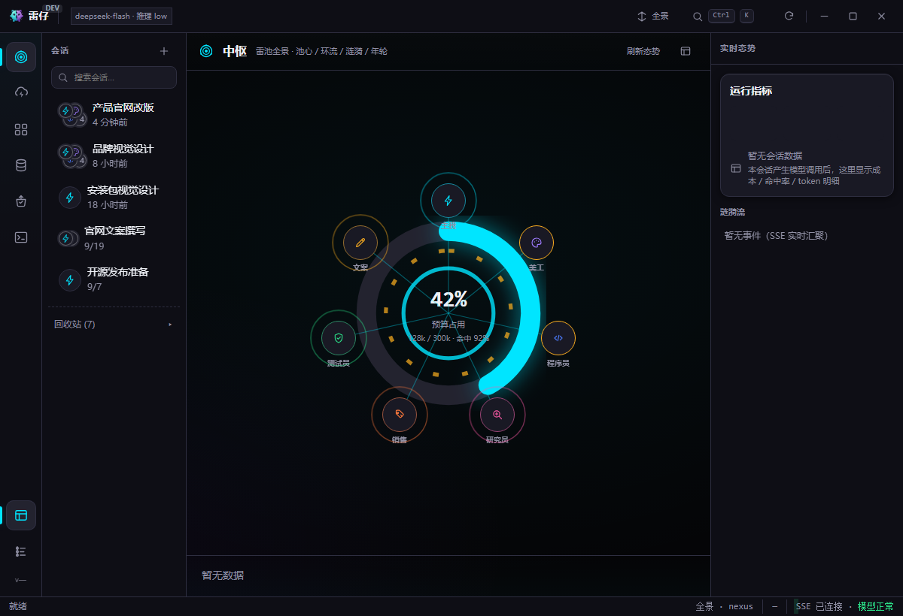
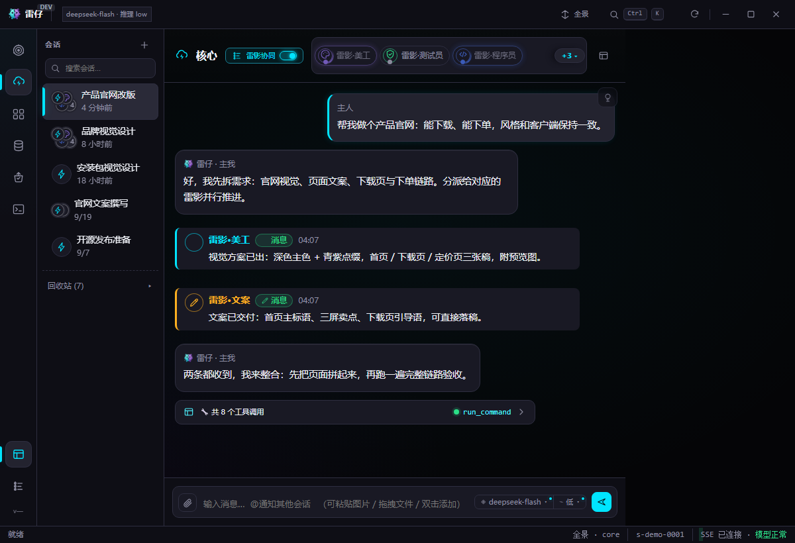

# 雷仔（Leizai）

> **你的电脑里，住着一支 AI 团队。**
> 一支本地运行、各司其职、还会越用越懂你的 AI 团队。你说人话，它拆活、分工、干活——数据一步都不出本机。

<p align="center">
  <a href="https://github.com/zhuang3719/leizai-releases/releases/latest"><b>⬇️ 下载最新安装包</b></a> &nbsp;|&nbsp;
  <a href="https://leizai.cc/download.html">官网下载页</a> &nbsp;|&nbsp;
  <a href="https://leizai.cc"><b>🌐 访问官网</b></a> &nbsp;|&nbsp;
  <a href="https://leizai.cc/docs.html">文档</a> &nbsp;|&nbsp;
  <a href="https://leizai.cc/opensource.html">开源说明</a>
</p>

---

## 本仓说明（重要）

> **本仓为引擎（Lite）源码**（引擎 / 外壳 / 协议 / UI）；核心能力（会话树 / 雷影 / 记忆 / 进化 / 反思 / 信箱）为**专有（Proprietary）**、**不在此仓**。**完整客户端安装包请到 [Releases](https://github.com/zhuang3719/leizai-releases/releases/latest) 或 [官网下载页](https://leizai.cc/download.html) 获取**。详见 [开源说明](https://leizai.cc/opensource.html) 与 `NOTICE`。

## 这是什么

雷仔是一支跑在**你自己电脑上**的 AI 团队：一个负责决策与拆解的「主我」，加一队各管一摊的「雷影」（写代码、做界面、写文案、跑测试、查资料、谈客户）。

- **开发者 / 一人公司**：需求写完没人帮你测，代码改到凌晨还怕漏 bug。
- **律师、会计这类碰数据的**：想把合同、账目交给 AI，又不敢传上去。
- **不太会用 AI 的老板**：别人说 AI 能干活，你打开对话框却不知道从哪问起。

说清楚要什么，剩下的它来。

---

## 凭啥用它

**🔒 数据不出本机**
文件、聊天、成果全部写在你本机磁盘；除了调用你自己配置的模型服务，不上传、不入第三方。

**🧠 聊再久，也不会忘事**
对话长成一棵「会话树」：主干是主线，按主题分出枝干。旧内容自动收起来，需要时顺着枝、搜个词就翻得回来——一个会话走完一个项目，不用开一堆会话。

**👥 一队雷影替你干活**
主我拆解派活，专长雷影并行执行、自动接力；进度、决定、产出都留档可查。

**💰 越聊越省**
前缀缓存让长会话的命中率长期稳定在高位，聊上百轮也不心疼。

> 另有 **Pro**（更高协作规模 / 企业能力，**仍在本机运行**），详见[官网](https://leizai.cc)。

---

## 界面截图

> 截图占位（客户端界面）—— 请替换为真实截图。




---

## 快速开始

前置：**Node.js >= 18**。

```bash
npm install          # 安装依赖（如无 package-lock 可跳过）
npm start            # 启动引擎（默认 http://127.0.0.1:3458）
# 首次运行以 src/config.js 的内置默认值启动；如需自定义，创建未跟踪的 config.json
```

> ⚠️ 请勿把真实密钥写入 `config.json` 并提交——本仓 `.gitignore` 已屏蔽 `config*.json` / `.env` 等。

开发与测试：

```bash
npm test             # 集成测试（scripts/integration-test.mjs）
npm run smoke        # 冒烟测试（scripts/api-smoke.mjs）
```

---

## 下载桌面版

不想碰命令行？直接下载桌面客户端：

- **最新安装包（GitHub Releases，公开仓仅安装包）**：<https://github.com/zhuang3719/leizai-releases/releases/latest>
- **官网下载页**：<https://leizai.cc/download.html>

- Windows 桌面版（Setup）与免安装便携版（Portable）
- 下载后请核对页面上的 SHA-256 校验值
- 免费版 **Lite** 即可上手

---

## 目录结构

```
src/            引擎核心（26 个 .js 模块 + plugins/）
webui/          前端界面（Vue ESM，免构建直接运行）
boot_splash/    启动动画素材
build-client/   桌面外壳构建素材（不含二进制）
docs/           开源说明与边界（公开口径）
scripts/        构建与冒烟测试脚本
```

## 数据位置与卸载（桌面版）

- **数据根**：`%LOCALAPPDATA%\LeiZaiData`（含 `config*.json`、`data/`、`workspace/`、`projects/`、`logs/`）。
- **卸载不会删除数据**：卸载程序只移除安装目录 `%LOCALAPPDATA%\LeiZai`（程序文件），数据目录独立存放，重装后原数据仍在。
- **手动清理**：如需彻底清除，关闭程序后删除 `%LOCALAPPDATA%\LeiZaiData` 即可。
- 便携版（Portable）数据跟随解压目录；可用 `portable.flag` 标记绿色目录。

## 版本与源码 tag

源码 tag 对应产品版本；产品版本因壳/打包变更也会递增；部分小版本引擎源码无变更时未单独打 tag。

## 开源口径与许可

- **Lite 全量开源**：以 **Apache License 2.0** 发布，可审查、可编译、可自行部署。详见 [LICENSE](./LICENSE)。
- **Pro 为闭源私模**：提供更高协作规模与企业能力，**仍在本机运行**；开源与商业的边界见 [`NOTICE`](./NOTICE) 与官网开源说明。
- 发布物完整性校验：使用 Ed25519 验签（私钥不在仓库中）。

## 贡献

欢迎提交 Issue / PR，见 [CONTRIBUTING.md](./CONTRIBUTING.md)。

---

## 联系与社群

有问题、想交流，欢迎扫码加入微信群：


> 也可到 GitHub / Gitee Issues 提问。

---

## 链接

| | |
|---|---|
| 官网 | <https://leizai.cc> |
| 下载最新安装包（Releases） | <https://github.com/zhuang3719/leizai-releases/releases/latest> |
| 下载桌面版（官网） | <https://leizai.cc/download.html> |
| 文档 | <https://leizai.cc/docs.html> |
| 开源说明 | <https://leizai.cc/opensource.html> |
| 微信社群 | `docs/assets/wechat-group.jpg` |
| 问题反馈 | GitHub / Gitee Issues |
